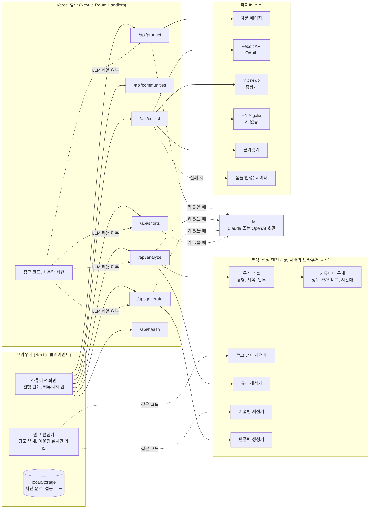
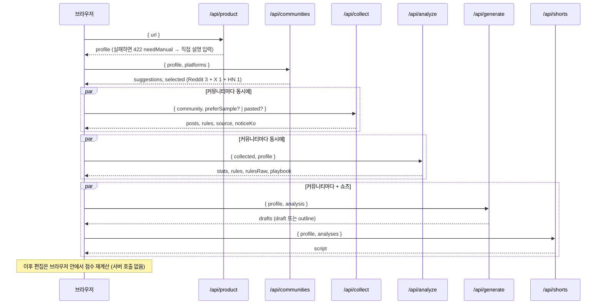
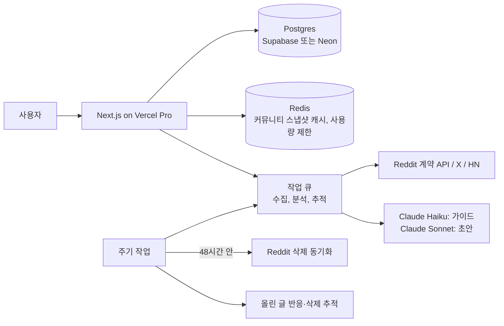

# 구현 구상도

이 문서는 데모가 지금 어떻게 동작하는지와, 실서비스로 갈 때 무엇을 붙이는지를 함께 적었습니다. 기획 배경은 [기획서](./PLAN.md)에 있습니다.

## 1. 한눈에 보는 구조



핵심 설계 세 가지:

1. **단계별 API.** 한 번에 다 하는 대신 제품 → 커뮤니티 → 수집 → 분석 → 생성으로 나눠서 브라우저가 차례로 부릅니다. 함수 하나가 오래 걸리지 않고, 화면에 진행 상황을 보여 줄 수 있고, 한 커뮤니티가 실패해도 나머지는 계속됩니다.
2. **결정적 엔진 + 선택형 LLM.** 통계, 광고 냄새, 규칙 해석, 어울림은 전부 규칙 기반이라 키 없이도 동작하고, 같은 코드가 브라우저에서도 돕니다(편집기 실시간 점수). LLM은 있으면 가이드와 초안 품질을 올리는 선택 사항이고, 실패하면 템플릿 결과로 돌아갑니다.
3. **출처를 끝까지 들고 다닌다.** 모든 수집 결과에 `source: live | sample | pasted`가 붙고, 화면과 내보내기 파일에 그대로 표시됩니다.

## 2. 요청 흐름



## 3. 폴더 지도

```
app/
  page.tsx                 첫 화면 (실제 채점기와 샘플 결과로 렌더)
  studio/page.tsx          스튜디오 (Suspense 안의 클라이언트 컴포넌트)
  blueprint/page.tsx       기획과 구조 요약
  api/*/route.ts           단계별 API
components/
  StartForm.tsx            URL 입력 폼 (GET 폼, 자바스크립트 없이도 동작)
  ui.tsx                   버튼, 도장, 눈금 같은 작은 부품
  studio/Studio.tsx        진행 상태, 결과 화면, 제품 정보 고치기, 커뮤니티 추가
  studio/GuidePanel.tsx    현지 가이드 (overview / reference)
  studio/Manuscript.tsx    원고 편집기와 점검 결과
  studio/MarkedField.tsx   textarea + 표시 레이어 (빨간 펜, 형광펜, 파란 칸)
  studio/ShortsBoard.tsx   쇼츠 대본
  studio/export.ts         마크다운 내보내기
lib/
  types.ts                 공용 타입
  text.ts                  토큰, 대소문자, 사전, 통계 함수
  analysis/                features, community, timing, adsmell, rules, fit, playbook
  generate/                english(문장 도우미), templates(초안), shorts(대본)
  llm/                     provider(Claude, OpenAI 호환), prompts, schemas(zod)
  sources/                 product(페이지 추출, SSRF 방지), reddit, x, hn, paste
  fixtures/                샘플 제품, 샘플 커뮤니티(합성 글과 규칙)
  collect.ts               소스 선택과 샘플 폴백
  directory.ts             커뮤니티 후보 35곳과 추천 점수
  pipeline.ts              제품 정리, 분석, 초안, 쇼츠 (LLM → 실패 시 템플릿)
  server/guard.ts          접근 코드, 사용량 제한, JSON 응답
  server/schemas.ts        API 요청 검증
  client/                  api(fetch, 저장), marks(편집기 표시 계산)
tests/                     vitest 62개 (엔진, 소스 변환, LLM 응답 처리, API)
```

## 4. API 명세

모든 요청은 `POST` JSON(헬스만 `GET`), 응답은 `cache-control: no-store`. 오류는 `{ error: "한국어 메시지" }`.

| 경로 | 요청 | 응답 | 비고 |
|---|---|---|---|
| `GET /api/health` | - | `{ llm, model, reddit, x, hn, accessCodeRequired }` | 키 값은 내보내지 않음 |
| `/api/product` | `{ url }` 또는 `{ url?, manual: { name, description } }` | `{ profile, noticeKo? }` | 페이지를 못 읽으면 `422 { error, needManual: true }` |
| `/api/communities` | `{ profile, platforms[] }` | `{ suggestions[], selected[] }` | 샘플 제품이면 샘플 있는 곳 우선 |
| `/api/collect` | `{ community, preferSample? }` 또는 `{ community, pasted: { posts, rules? } }` | `CollectResult` | 실시간 실패 시 샘플 + `noticeKo`, 샘플도 없으면 `422` |
| `/api/analyze` | `{ collected, profile }` | `CommunityAnalysis` | LLM 있으면 가이드를 LLM으로 |
| `/api/generate` | `{ profile, analysis, tone?, length? }` | `GenerateResult` | AI 금지 커뮤니티는 LLM 호출 없이 뼈대 |
| `/api/shorts` | `{ profile, analyses[], format?, seconds? }` | `{ script, noticeKo? }` | 30/45/60초 |

LLM을 쓰는 경로에는 `export const maxDuration = 60`을 걸었습니다(Vercel Hobby도 Fluid compute 기준 최대 300초).

## 5. 데이터 모델

화면과 API가 공유하는 타입은 `lib/types.ts`에 있습니다. 주요 모양:

```ts
ProductProfile   { url, name, oneLiner, oneLinerKo?, category, audience[], problems[], features[], pricing, stage, keywords[], source, extractedBy }
CollectResult    { community, about?, posts: Post[], rules: CommunityRule[], source: "live" | "sample" | "pasted", fetchedAt, noticeKo? }
CommunityStats   { n, engagement, title, body, tone, archetypes[], lifts[], phrases[], timing, adSmell, topPosts[], examples[], flairs[] }
RulesAnalysis    { selfPromo: { policy, labelKo, evidence[], noteKo }, aiContent: { level: none | limited | banned }, flairRequired, promoDays[], promoDaysNoteKo?, checklistKo[] }
Draft            { id, angle, angleKo, title, body, thread?, firstComment?, whyKo[], glossKo[], glossKind, mode: draft | outline, postTimingKo?, flairSuggestion? }
```

데모는 DB가 없습니다. 결과와 고친 내용은 브라우저 localStorage에만 저장합니다. 실서비스용 스키마 초안:

```sql
create table users (
  id uuid primary key, email text unique not null, plan text not null default 'free', created_at timestamptz default now()
);
create table products (
  id uuid primary key, user_id uuid references users on delete cascade,
  url text, profile jsonb not null, created_at timestamptz default now()
);
-- 커뮤니티 분석은 사용자끼리 공유하는 캐시. 원문 글은 저장하지 않고 통계만 남긴다 (Reddit 삭제 의무 대응)
create table community_snapshots (
  id uuid primary key, platform text not null, community_id text not null,
  source text not null, stats jsonb not null, rules jsonb not null,
  fetched_at timestamptz not null, expires_at timestamptz not null,
  unique (platform, community_id, fetched_at)
);
create table drafts (
  id uuid primary key, product_id uuid references products on delete cascade,
  snapshot_id uuid references community_snapshots, angle text, mode text,
  original jsonb not null, edited jsonb, engine text, created_at timestamptz default now()
);
-- v1: 사용자가 올린 글 추적 (북극성 지표)
create table posted (
  id uuid primary key, draft_id uuid references drafts on delete set null,
  platform text, url text not null, posted_at timestamptz,
  last_checked_at timestamptz, score int, comments int, removed boolean, removed_reason text
);
create table usage (user_id uuid references users, day date, analyses int default 0, llm_tokens int default 0, x_reads int default 0, primary key (user_id, day));
```

## 6. 분석 알고리즘

- **특징 추출** `lib/analysis/features.ts`: 게시물마다 제목 길이·대소문자·질문형·숫자·1인칭·말머리, 본문 단어 수·문단·목록·링크·첫머리 링크·질문으로 끝남, 축약형 빈도, 현지 표현, 해시태그, 만든 사람 공개, 평균 문장 길이, 유형, 광고 냄새, 업로드 요일과 시간, 반응 점수를 뽑습니다.
- **유형 분류 순서**: 성과 공유 → 피드백 요청 → 경험담(강한 신호) → 만든 것 공개 → 경험담(기간 표현) → 방법 공유 → 의견 → 질문 → 기타. 겹칠 때 더 구체적인 쪽을 먼저 봅니다.
- **상위 25% 비교** `lib/analysis/community.ts`: 반응 점수 상위 25%와 나머지의 특징 비율을 비교하고, 차이가 20%p 이상인 것 최대 5개를 보여 줍니다. 표본이 12개 미만이면 하지 않습니다.
- **시간대** `lib/analysis/timing.ts`: 반응 상위 절반의 업로드 시각을 한국 시간 3시간 단위로 세고 연속 6시간 최다 구간을 고릅니다. 서머타임 판단 기준일은 데이터의 가장 최근 글 날짜라서 결과가 항상 같습니다. 미국 요일 규칙은 "미국 본토 모든 시간대와 UTC에서 모두 그 요일인 구간"(한국 시간 그 요일 오후 5시 ~ 다음 날 오전 9시)으로 바꿉니다.
- **광고 냄새** `lib/analysis/adsmell.ts`: 패턴마다 가중치와 한국어 메모·고칠 방법을 가진 사전으로 위치까지 찾고, 겹치는 표시는 무거운 쪽만 남깁니다. 공식과 구간은 기획서 7장.
- **규칙 해석** `lib/analysis/rules.ts`: "No spam"처럼 어디에나 있는 규칙은 홍보 금지로 보지 않고, 홍보를 직접 다루는 규칙에서만 요일, 정기 스레드, 비율, 금지 표현을 찾습니다. 커뮤니티 소개 문구도 허용 판단에 씁니다. AI 규칙은 "성의 없는/명백한" 같은 수식이 붙으면 제한(limited), 아니면 금지(banned)입니다.
- **어울림** `lib/analysis/fit.ts`: 해당하는 점검 항목만 가중 평균. 정기 스레드 댓글은 제목·길이 항목을 빼고 봅니다.

## 7. 생성

- **템플릿** `lib/generate/templates.ts`: 커뮤니티 판정으로 각도를 고르고(기획서 8장 표), 한 줄 소개를 동사구로 해석해 문장을 잇고, 제목 후보 중 그 동네 중간 길이에 가장 가까운 것을 고르고, 대소문자 스타일을 입히고, 본문이 짧은 동네에서는 우선순위 낮은 문단(가격·상태 → 기능 목록)부터 덜어 냅니다. 영어가 아닌 제품 정보는 문장에 넣지 않고 [채울 칸]으로 남깁니다.
- **LLM** `lib/llm/`: Claude는 Messages API에 도구 하나를 강제로 쓰게 해서(`tool_choice: { type: "tool" }`) JSON을 받고, OpenAI 호환은 JSON 모드를 씁니다. 같은 zod 스키마로 도구 스키마를 만들고 응답도 검증합니다. 시스템 프롬프트에 정직 규칙 다섯 가지가 들어갑니다(`HONESTY_RULES`).
- **기본 모델**: `claude-sonnet-5-5` (`ANTHROPIC_MODEL`로 변경). 비용을 줄이려면 `claude-haiku-5-5`.

## 8. 보안과 남용 방지

| 항목 | 지금 | 실서비스 |
|---|---|---|
| SSRF | http/https만, 포트 제한, 내부 호스트·사설 IP 차단, DNS 결과 검사, 리다이렉트마다 재검사, 1.5MB 제한, 8초 타임아웃 | DNS 재바인딩까지 막으려면 고정 IP로 연결하는 fetch 에이전트 사용 |
| LLM 키 남용 | `ACCESS_CODE`가 있으면 코드 없는 요청은 템플릿 모드, IP당 10분 40회(인스턴스 메모리) | Upstash Redis 같은 외부 저장소로 사용량 제한, 로그인 사용자별 쿼터 |
| 키 노출 | 키는 서버 환경 변수에만, health는 켜짐 여부만 | 동일 |
| 입력 검증 | zod로 모든 요청 모양과 크기 검사 | 동일 |
| 스팸 악용 | 자동 게시 없음 | 같은 문구를 여러 커뮤니티에 올리려 할 때 경고, 일일 생성 제한 |

## 9. 배포 (Vercel)

1. Vercel에서 `mnunu123/demo` 저장소를 가져옵니다(Framework: Next.js, 설정 그대로).
2. 환경 변수는 선택입니다. 하나도 없으면 템플릿 모드 + HN 실시간 + 나머지 샘플로 동작합니다.

| 변수 | 용도 |
|---|---|
| `ANTHROPIC_API_KEY` | Claude로 제품 정리, 가이드, 초안, 쇼츠 |
| `ANTHROPIC_MODEL` | 기본 `claude-sonnet-5-5` |
| `OPENAI_API_KEY`, `OPENAI_MODEL`, `OPENAI_BASE_URL` | Claude 대신 OpenAI 호환 API (둘 다 있으면 Claude 우선) |
| `ACCESS_CODE` | 설정하면 이 코드를 넣은 사람만 LLM 사용 |
| `LLM_RATE_LIMIT` | IP당 10분 LLM 호출 수 (기본 40) |
| `REDDIT_CLIENT_ID`, `REDDIT_CLIENT_SECRET`, `REDDIT_USER_AGENT` | 승인받은 Reddit 앱 |
| `X_BEARER_TOKEN`, `X_MAX_RESULTS` | X 최근 검색 (기본 50개, 호출마다 과금) |

3. 공개 URL로 배포하면서 LLM 키를 넣는다면 `ACCESS_CODE`도 같이 넣는 걸 권합니다.

## 10. 실서비스로 갈 때 붙일 것



- 커뮤니티 스냅샷 캐시(6시간): 같은 커뮤니티를 여러 사용자가 보므로 X 과금과 LLM 비용을 나눠 냅니다.
- 원문은 짧게만 보관하고 통계만 남깁니다. Reddit에서 지워진 글은 48시간 안에 지웁니다.
- 올린 글 추적: 사용자가 게시 URL을 넣으면 1시간, 24시간, 7일 뒤 반응과 삭제 여부를 기록합니다. 이 데이터가 쌓이면 "이 동네에서 살아남는 글" 모델을 만들 수 있고, 그게 이 서비스의 진짜 자산이 됩니다.
