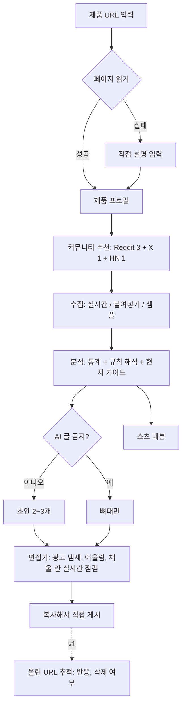

# Lurk 기획서

> 올리기 전에, 그 동네 글부터 읽어 드려요.

마케팅 예산이 없는 1인 창업가가 해외 커뮤니티(Reddit, X, Hacker News)에 제품을 알릴 때, 광고로 찍혀 지워지지 않도록 돕는 웹 서비스입니다. 제품 URL을 넣으면 타깃 커뮤니티에서 지금 반응 좋은 글의 패턴과 말투를 분석하고, 그 커뮤니티 문법에 맞는 게시글 초안과 쇼츠 대본을 만들고, 쓰는 동안 "광고 냄새"를 실시간으로 점검합니다.

- 기준일: 2026년 10월 21일
- 관련 문서: [구현 구상도](./ARCHITECTURE.md), [인수인계](./HANDOFF.md)

---

## 0. 결론부터: 지금 이 아이디어가 부딪히는 현실

기술보다 플랫폼 정책이 더 큰 문제입니다. 기획 전체가 아래 여섯 가지를 전제로 짜여 있습니다.

| # | 사실 | 이 서비스에 주는 영향 | 출처 |
|---|---|---|---|
| 1 | Reddit은 2025년 11월 11일 API 셀프 신청을 닫고 승인제로 바꿨습니다(Responsible Builder Policy). 상업적 사용, AI 학습, 자동 게시는 서면 승인 없이는 금지입니다. | 승인 없이 서버에서 Reddit 글을 모으는 유료 서비스는 운영할 수 없습니다. | [Reddit Help](https://support.reddithelp.com/hc/en-us/articles/42728983564564-Responsible-Builder-Policy) |
| 2 | 2026년 9월 30일 발표: 신규 공개 API 신청은 **10월 31일**에 마감, RSS는 11월 13일 종료, 미등록 앱은 2027년 1월 12일부터 접근 제거, 남은 공개 API는 2027년 3월 종료. 이후 소셜 리스닝, 리서치, AI 도구는 상업 계약이 필요합니다. | Reddit 실시간 분석은 "계약을 따내야만 가능한 기능"이 됩니다. 신청 마감이 열흘 남았습니다. | [TechCrunch](https://techcrunch.com/2026/09/30/reddit-is-killing-rss-feeds-ending-public-api-access-because-of-ai-bots/), [TechRepublic](https://www.techrepublic.com/article/news-reddit-rss-public-api-shutdown/) |
| 3 | Reddit 리서치 도구 GummySearch는 Reddit과 상업 라이선스 조건을 맞추지 못해 2025년 11월 30일 판매를 멈췄고 2026년 12월 1일 완전히 문을 닫습니다. | 같은 길을 먼저 간 서비스가 같은 벽에서 멈췄습니다. | [GummySearch](https://gummysearch.com/final-chapter) |
| 4 | Hacker News 가이드라인은 게시물에 생성된 글을 넣지 말고, 댓글에 생성되거나 AI로 다듬은 글을 쓰지 말라고 합니다. 큰 서브레딧(상위 1%)의 17.1%가 AI 관련 규칙을 두고 있고, 조사된 AI 규칙의 55.2%는 전면 금지입니다(2024년 11월 기준). | "AI가 대신 써 주는 도구"로 만들면 핵심 채널의 규칙과 정면으로 부딪힙니다. | [HN 가이드라인](https://news.ycombinator.com/newsguidelines.html), [Cornell CHI '25 연구](https://arxiv.org/html/2410.11698v3) |
| 5 | r/SaaS는 2026년 6월 9일, 리드 탐지나 광고, 홍보 글 생성 도구의 홍보를 금지했습니다. 어기면 영구 차단과 URL 블랙리스트입니다(미러 사이트로 확인). | 이 서비스 자체를 r/SaaS에서는 홍보할 수 없고, 이 카테고리가 커뮤니티에서 미움받고 있다는 신호입니다. | [r/SaaS 미러](https://redlib.groet-infra.nl/r/SaaS) |
| 6 | X API는 2026년 2월 6일부터 종량제입니다. 게시물 읽기 1건에 $0.005라서 100개 검색 한 번에 $0.50입니다. 새 개발자용 무료 읽기는 없습니다. | X 분석은 호출마다 원가가 생깁니다. 캐시가 필수입니다. | [X 가격](https://docs.x.com/x-api/getting-started/pricing), [X 변경 기록](https://docs.x.com/changelog) |

**그래서 방향을 이렇게 잡았습니다.**

1. **대필 도구가 아니라 코치.** 데이터로 "그 동네에서 통하는 방식"을 알려 주고, AI 글을 허용하는 곳에서만 초안을 줍니다. AI 글을 금지하는 곳(HN, 일부 서브레딧)에서는 뼈대만 주고, 사용자가 직접 쓰는 동안 점검만 합니다.
2. **Reddit 의존도를 낮춘 데이터 구조.** 키 없이 쓸 수 있는 HN을 실시간 소스로 쓰고, Reddit은 (1) 승인된 OAuth 앱, (2) 사용자가 직접 붙여 넣은 글, (3) 상업 계약 순서로 접근합니다. 붙여넣기는 국내 커뮤니티나 디스코드처럼 API가 없는 곳에도 그대로 쓸 수 있습니다.
3. **정직이 기본값.** 만든 사람이라는 문장이 기본으로 들어가고, 모르는 숫자는 [채울 칸]으로 남기고, 자동 게시는 하지 않습니다. 원칙이기도 하지만, 그렇게 써야 실제로 덜 지워집니다.

**지금 바로 할 일 (마감 있음):** 실서비스를 생각한다면 10월 31일 전에 Reddit 개발자 접근을 신청해 두세요. 승인을 받아도 상업적 사용은 별도 서면 승인이 필요하다는 점은 같습니다.

---

## 1. 문제

1인 창업가에게 해외 커뮤니티는 돈 안 드는 거의 유일한 채널입니다. 그런데 글을 올리면 이런 일이 생깁니다.

- **광고로 보여서 지워지거나 비추천을 받습니다.** 과장 형용사, 가입 권유, 🚀 이모지, 첫 줄 링크 같은 습관 때문입니다.
- **규칙이 커뮤니티마다 다르고 잘 안 보입니다.** "토요일만 홍보 가능", "정기 스레드에만", "9:1 비율", "AI 글 금지", 플레어 필수 같은 규칙이 사이드바와 자동 관리 봇에 흩어져 있습니다.
- **현지 말투를 모릅니다.** 특히 영어가 편하지 않은 한국 창업가는 번역투나 보도자료 말투가 되기 쉽습니다.
- **계정이 준비되지 않았습니다.** 새 계정이나 카르마가 낮은 계정은 자동으로 걸러지는 곳이 많고, 기준은 대개 공개되지 않습니다.
- **올리는 시간이 안 맞습니다.** 미국 오전은 한국 밤 10시~새벽 2시입니다.

지금 쓰는 해결책은 각각 한계가 있습니다.

| 대안 | 한계 |
|---|---|
| ChatGPT에 "레딧용으로 써 줘" | 실제 커뮤니티 데이터와 규칙을 모르고, 결과물이 전형적인 AI 말투입니다. |
| 몇 주 직접 눈팅 | 정답이지만 시간이 많이 듭니다. 이 서비스가 줄이려는 시간이 이것입니다. |
| 마케팅 대행 | 1인 창업가 예산으로는 어렵습니다. |
| 자동 답글 도구 | 계정 차단과 평판 손상 위험이 큽니다(아래 경쟁 분석 참고). |

## 2. 누구를 위한 서비스인가

- **1차 사용자:** 한국의 1인 또는 소규모 메이커(인디 개발자, 1인 SaaS, 앱과 확장 프로그램 개발자). 영어 커뮤니티에 처음 진출하고, 영어 글쓰기에 자신이 없습니다.
- **2차 사용자:** 같은 문제를 겪는 영어권 인디 해커, 작은 B2B 회사의 1인 마케터.

예시 페르소나: 크롬 확장 프로그램을 출시한 1인 개발자. r/SideProject에 두 번 올렸는데 둘 다 반응이 없었고, 한 번은 지워졌습니다. 왜 지워졌는지 모릅니다.

## 3. 무엇을 해 주나 (핵심 가치)

**입력:** 제품 URL. 페이지를 못 읽으면 제품 설명을 직접 받습니다.

**출력:**

1. **커뮤니티별 현지 가이드**: 분위기 요약, 홍보 규칙 판정(가능 / 조건부 / 금지 / 확인 필요), AI 글 규칙, 잘 되는 글 유형과 평균 대비 반응, 제목 길이와 대소문자, 말투, 상위 25% 글과 나머지의 차이, 현지 표현과 한국어 풀이, 반응 좋은 업로드 시간(한국 시간), 지워질 수 있는 이유
2. **초안 2~3개**: 커뮤니티 규칙에 따라 각도가 달라집니다(아래 8장). AI 글 금지 커뮤니티에서는 뼈대
3. **실시간 점검 편집기**: 고칠 때마다 광고 냄새 점수, 그 동네와의 어울림 점수, 채울 칸 개수, 빨간 펜 메모가 바뀝니다
4. **쇼츠 대본**: 같은 커뮤니티의 언어와 첫 문장 패턴을 빌린 30/45/60초 세로 영상 대본
5. **내보내기**: 전체 결과를 마크다운 한 파일로

**차별점**

| | 무엇이 다른가 |
|---|---|
| 데이터 기반 | "레딧은 이렇다더라"가 아니라 그 커뮤니티의 실제 상위글로 계산합니다. 수치마다 표본 수와 출처(실시간 / 샘플 / 붙여넣기)를 함께 보여 줍니다. |
| 규칙 사전 점검 | 올리기 전에 홍보 가능 여부, 홍보 요일(한국 시간으로 변환), 플레어, AI 글 규칙을 알려 줍니다. |
| 한국어로 설명, 그 동네 말로 출력 | 가이드와 이유는 한국어, 초안은 커뮤니티 언어. 문단별 한국어 설명이나 번역을 붙입니다. |
| 정직 설계 | 공개 문구 기본 포함, [채울 칸], 자동 게시 없음, AI 금지 커뮤니티는 뼈대만. |
| 쇼츠까지 한 번에 | 같은 분석으로 쇼츠 대본까지 만듭니다. |

## 4. 경쟁과 대체재

| 서비스 | 하는 일 | 가격 | 자동 게시, 답글 | 출처 |
|---|---|---|---|---|
| ReplyGuy | Reddit, X 키워드를 지켜보다 답글 초안 작성 | $39~$499/월 | 상위 요금제에서 게시 | [경쟁사 리뷰](https://redship.io/reddit-tool/replyguy) |
| Redreach | 구매 의도가 있는 글 찾기, AI 초안, DM 확장 프로그램 | $19~$79/월 | 제한적 | [경쟁사 리뷰](https://redship.io/reddit-tool/redreach) |
| Subreddit Signals | 구매 의도 순으로 글 정렬, 내 말투로 초안 | $29~$59/월 | 안 함 | [공식](https://www.subredditsignals.com/) |
| Syften | Reddit, HN, X 등 알림 | $29.95~$119.95/월 | 안 함(알림만) | [공식](https://syften.com/pricing) |
| F5Bot | Reddit, HN 키워드 알림 | 무료~$49.99/월 | 안 함 | [공식](https://f5bot.com/) |
| Typefully | X 등 글 작성과 예약 게시 | 무료 요금제 있음 | 예약 게시 | [공식](https://typefully.com/) |
| Reddit Pro, Reddit Insights | 키워드 트렌드, 커뮤니티 스냅샷(규칙, 통계), 광고주용 리스닝 | Reddit Pro 무료 | 해당 없음 | [TechCrunch](https://techcrunch.com/2025/01/07/reddit-intros-new-trends-tools-for-businesses-and-an-ama-ad-format/), [Search Engine Land](https://searchengineland.com/reddit-pro-new-features-public-beta-472991) |
| Reddit 광고 생성기(베타) | 브랜드 웹사이트와 Reddit 글로 Reddit 스타일 광고 생성 | 비공개 | 광고 상품 | [Axios](https://axios.com/2026/06/22/reddit-ads-shopping-community-intelligence) |
| GummySearch | Reddit 오디언스 리서치 | 종료 | 해당 없음 | [공식](https://gummysearch.com/final-chapter) |

**포지셔닝.** 알림과 탐색 도구는 "어디서 말할지"를, 자동 답글 도구는 "대신 말하기"를 팝니다. Lurk는 "그 동네에서 어떻게 말하는지"를 데이터로 보여 주고, 쓰는 사람을 돕습니다.

**경계할 점.** 가장 가까운 위협은 Reddit 자신입니다. Reddit Pro는 퍼블리셔용 무료 베타에서 커뮤니티 규칙과 통계를 보여 주는 기능을 내놨고, 광고 생성기는 "웹사이트 URL → Reddit 스타일 문구"라는 흐름이 우리와 겹칩니다. 다만 Reddit 도구는 Reddit 안에서만, 광고 중심으로 동작합니다. 여러 플랫폼을 한 번에 보고 정직한 자연 게시를 돕는 쪽은 비어 있습니다.

**반면교사.** 404 Media는 ReplyGuy가 여러 계정으로 제품 홍보 답글을 달았고 그중 다수가 차단됐다고 보도했습니다([404 Media](https://www.404media.co/ai-is-poisoning-reddit-to-promote-products-and-game-google-with-parasite-seo/)). Reddit은 2026년 3월부터 봇으로 의심되는 계정에 사람임을 증명하게 하고 있습니다([TechCrunch](https://techcrunch.com/2026/03/25/reddit-bots-new-human-verification-requirements)). 자동화로 가면 막힙니다.

## 5. 기능 범위

| 단계 | 기능 |
|---|---|
| **MVP (이 데모)** | URL → 제품 프로필 (규칙 기반, LLM 있으면 LLM) / 커뮤니티 추천 (디렉터리 35곳) / 수집: HN 실시간, Reddit OAuth 또는 공개 주소, X(키 있을 때), 붙여넣기, 실패 시 샘플 / 분석: 유형, 제목, 말투, 상위 25% 비교, 현지 표현, 시간, 광고 냄새 기준선, 규칙 해석 / 생성: 규칙 따라 각도 선택, AI 금지는 뼈대 / 실시간 점검 편집기 / 쇼츠 대본 / 마크다운 내보내기 / 브라우저 저장 |
| **v1 (출시)** | 로그인과 프로젝트 저장 / 커뮤니티 분석 캐시(여러 사용자가 같은 커뮤니티 결과 공유) / 계정 준비도 점검(계정 나이와 카르마 입력 → 경고) / 올린 글 추적(올린 URL을 넣으면 반응과 삭제 여부를 기록) / 국내 채널: GeekNews Show GN / 결제 |
| **v2** | 올린 글 결과로 커뮤니티별 "살아남는 글" 모델 학습 / 홍보 전 "댓글로 먼저 기여하기" 코치 / 홍보 가능 요일 캘린더 / 일본어 커뮤니티(X 個人開発 등) / 팀 기능 |

**일부러 만들지 않는 것:** 자동 게시, 자동 댓글, 여러 계정 관리, 카르마 쌓기 대행, 다른 사람인 척하는 글, 가짜 후기. 4장의 반면교사와 같은 길입니다.

## 6. 사용자 흐름

화면은 세 개입니다.

1. **첫 화면** `/`: 무엇을 하는지, 광고 문장과 고친 문장 비교(실제 채점기로 계산), 동네마다 달라지는 실제 결과, 하지 않는 것
2. **스튜디오** `/studio`: 진행 단계 → 결과. 결과 화면은 커뮤니티 탭 + 왼쪽 현지 가이드 + 오른쪽 원고 편집기와 점검 결과, 그 아래 쓰는 법, 제목 공식, 지금 반응 좋은 글. 쇼츠 대본 탭, 커뮤니티 추가(추천 목록 / 붙여넣기)
3. **기획과 구조** `/blueprint`: 이 문서의 요약과 시스템 구상도

## 7. 분석 엔진

LLM 없이도 돌아가는 규칙 기반 통계가 먼저입니다. 같은 입력이면 항상 같은 결과가 나오고, 편집기에서 글자를 고칠 때마다 브라우저에서 바로 다시 계산합니다.

| 지표 | 계산 방법 | 쓰는 곳 |
|---|---|---|
| 반응 점수 | log(1+추천) + log(1+댓글) + 0.5·log(1+공유) | 상위 25% 구분, 정렬 |
| 글 유형 | 제목 패턴으로 분류: 만든 것 공개, 피드백 요청, 성과 공유, 경험담, 방법 공유, 질문, 의견 | 유형별 비중과 평균 대비 반응 |
| 제목 | 글자 수 사분위, 대소문자 스타일, 질문형, 숫자, 1인칭, 말머리 | 길이와 표기 맞추기 |
| 본문 | 단어 수 사분위, 목록, 링크, 질문으로 끝나는 비율 | 링크 위치, 끝맺음 |
| 말투 | 축약형 빈도, 이모지, 느낌표, 해시태그, 문장 길이, 현지 표현 사전 60여 개 | 말투 판정(구어체 / 설명체 / 문어체) |
| 상위 25% vs 나머지 | 특징별 비율 차이가 20%p 이상인 것만, 표본 12개 이상일 때만 | "반응 좋은 글은 이게 달라요" |
| 시간 | 상위 절반 글의 업로드 시각을 한국 시간 3시간 단위로, 연속 6시간 최다 구간 | 올릴 시간(미국 동부 시간 병기) |
| 광고 냄새 | 아래 공식 | 기준선(중간값), 반응과의 순위 상관 |
| 규칙 | 규칙 문장에서 홍보 정책, 요일, 정기 스레드, 비율, AI 글, 플레어, 링크, 계정 조건 추출 | 홍보 판정, 초안 각도 선택 |

**광고 냄새 점수 (0~100)**

- 더하는 신호: 과장 표현(3단계 가중치), 판매와 가입 권유, 보도자료 말투("Introducing", "excited to announce"), 최상급, 런칭 이모지, 느낌표 연타, 대문자 강조, 해시태그(Reddit, HN), 첫머리 링크, 추적 링크와 단축 링크, 추천 요청
- 빼는 신호: 읽는 사람에게 질문, 구체적인 피드백 요청, 직접 겪은 이야기, 만든 사람 공개, 구체적인 숫자 (최대 22점)
- 공식: `100 × (1 − e^(−max(0, 더하기 / 길이보정 − 빼기) / 16))`, 길이보정 = max(1, √(단어 수 / 120))
- [채울 칸] 안의 글자는 계산에서 뺍니다
- 구간: 0~24 현지인 같음, 25~49 살짝 홍보 티, 50~74 광고 냄새, 75~ 삭제 위험

**어울림 점수 (0~100):** 제목 길이(12), 표기(8), 본문 길이(10), 이모지(8), 말투(10), 질문 끝맺음(10), 링크 위치(12), 만든 사람 공개(10), 광고 냄새가 그 동네 상위권 범위 안인지(15), 플랫폼 한도(X 280자, HN 제목 형식과 80자, 15). 해당하는 항목만 가중 평균합니다.

## 8. 생성 엔진

**초안 각도는 규칙이 정합니다.**

| 커뮤니티 판정 | 초안 |
|---|---|
| 홍보 가능 | 만든 이야기 / 피드백 요청 / 경험담 |
| 조건부(요일 제한) | 만든 이야기와 피드백 요청(홍보 가능 시간 표시) / 경험담(아무 날) |
| 조건부(정기 스레드만) | 스레드용 짧은 소개 / 링크 없는 경험담 / 제품 언급 없는 질문 |
| 홍보 금지 | 링크 없는 경험담 / 제품 언급 없는 질문 |
| AI 글 금지 | 위 각도를 뼈대로만 (LLM이 있어도 대신 쓰지 않음) |
| X | 스레드 4개 / 만드는 과정 공유 / 피드백 요청 한 트윗 |
| Show HN | 본문형 / 링크 + 첫 댓글 (HN은 AI 글 금지라 뼈대) |

**정직 규칙 (템플릿과 LLM 공통)**

1. 제품을 말하면 만든 사람이라는 걸 밝힌다
2. 숫자, 사용자 수, 매출, 후기, 경험담을 지어내지 않는다. 모르면 [한국어 안내가 있는 채울 칸]
3. 다른 사람인 척하는 글을 쓰지 않는다
4. 규칙을 지킨다. 홍보 금지면 제품 이름과 링크를 뺀다
5. 과장 표현, 가입 권유, 런칭 이모지를 쓰지 않는다(그 동네가 쓰는 경우 제외)

**두 가지 엔진**

- **템플릿 엔진 (키 없을 때, 항상 폴백):** 제품 프로필의 한 줄 소개를 동사구로 해석하고(Turns X into Y → It turns X into Y), 그 동네 제목 길이 중간값에 가장 가까운 후보를 고르고, 대소문자 스타일을 적용하고, 본문이 짧은 동네에서는 문단을 덜어 냅니다.
- **LLM 엔진 (Claude 또는 OpenAI 호환):** 통계 요약, 상위글 예시, 원문 규칙, 정직 규칙을 넣고 정해진 JSON 모양으로 받습니다. 실패하면 템플릿 결과와 이유를 함께 보여 줍니다.

## 9. 데이터 소스와 정책

| 소스 | 접근 | 비용 | 지금 상태 | 대응 |
|---|---|---|---|---|
| Reddit | OAuth 앱 전용 토큰. 비 OAuth 요청은 차단, OAuth 클라이언트당 분당 100회 | 공개 가격 없음. 상업 사용은 별도 계약 | 승인제(2025-11), 신규 공개 신청 10/31 마감, 2027-03 공개 API 종료 | 데모: OAuth 또는 공개 주소 시도 → 실패 시 샘플. 실서비스: 붙여넣기 → 브라우저 확장(약관 검토 후) → 상업 계약 |
| X | v2 최근 검색(7일), 앱 Bearer 토큰 | 게시물 읽기 1건 $0.005 | 종량제(2026-02) | 커뮤니티별 결과를 6시간 캐시해 여러 사용자가 공유 |
| Hacker News | Algolia HN Search API, 키 없음 | 무료 | 동작 중 | 실시간 기본 소스 |
| 제품 페이지 | 서버에서 직접 가져와 추출 | 무료 | - | 내부망 차단(SSRF 방지), 실패 시 직접 입력 |
| LLM | Claude Sonnet 5.5 / Haiku 5.5 | 아래 10장 | - | 키 없으면 템플릿 |

Reddit 데이터를 받으면 지켜야 할 것: Reddit에서 지워진 글과 계정은 우리 쪽에서도 지워야 하고, Reddit은 48시간 안에 처리하라고 권합니다([Data API Wiki](https://support.reddithelp.com/hc/en-us/articles/16160319875092-Reddit-Data-API-Wiki)). 그래서 원문 장기 저장 대신 통계와 짧은 캐시만 남기는 구조로 설계했습니다.

## 10. 비용 추정

공개 가격 기준 추정입니다([Claude 가격](https://platform.claude.com/docs/en/about-claude/pricing)). Sonnet 5.5는 입력 100만 토큰당 $2, 출력 $10. Haiku 5.5는 $0.10 / $0.50(10만 토큰 이하 프롬프트).

분석 1회(커뮤니티 5곳) 토큰 추정: 제품 정리 입력 3천 / 출력 5백, 가이드 5곳 입력 2만 / 출력 5천, 초안 5곳 입력 2.5만 / 출력 1.25만, 쇼츠 입력 3천 / 출력 1.5천. 합계 입력 약 5.1만, 출력 약 1.95만.

| 구성 | 1회 비용 |
|---|---|
| 전부 Sonnet 5.5 | 약 $0.30 |
| 정리와 가이드는 Haiku, 초안과 쇼츠는 Sonnet | 약 $0.20 |
| 전부 Haiku 5.5 | 약 $0.015 |
| X 커뮤니티 1곳 수집(50개) | $0.25 (캐시 적중 시 0) |
| 호스팅 | Vercel Pro $20/월(상업 사용은 Hobby 불가) |

## 11. 수익 모델

| 요금제 | 가격 | 내용 |
|---|---|---|
| 무료 | 0원 | 월 3회 분석(Haiku), 붙여넣기 분석 무제한, 편집기 점검 무제한 |
| Pro | 월 19,000원 (해외 $15) | 월 30회, 초안은 Sonnet, X 실시간, 올린 글 추적 |
| 팀 (v2) | 미정 | 여러 제품, 공유 |

**솔직한 단가 계산.** Pro 사용자가 30회를 꽉 채우고 매번 X까지 새로 수집하면 원가가 약 30 × ($0.20 + $0.25) = $13.5로 가격($15)과 거의 같습니다. 그래서 (1) 커뮤니티 분석 결과를 사용자 사이에 캐시로 공유하고(같은 커뮤니티를 여러 명이 봅니다), (2) 가이드는 Haiku로, (3) X는 기본으로 끄고 원할 때만 켜는 구조가 필요합니다. 캐시 적중률이 50%만 돼도 원가는 절반 가까이 내려갑니다.

## 12. 리스크와 대응

| 리스크 | 가능성 | 영향 | 대응 |
|---|---|---|---|
| Reddit 상업 접근 불가 | 높음 | 큼 | 붙여넣기 분석을 1급 기능으로, HN, X, 국내 채널 비중 확대, 트랙션 생기면 계약 협상 |
| AI 글 금지 확산 | 높음 | 큼 | 코치 포지셔닝(뼈대 모드, 점검 편집기). 금지 커뮤니티에서는 대신 쓰지 않음 |
| "AI 마케팅 도구"에 대한 커뮤니티 반감 | 높음 | 중간 | 정직 설계를 전면에, 스팸 기능 없음을 약속, r/SaaS 같은 금지 채널은 홍보하지 않음 |
| 초안이 템플릿 티가 남 | 중간 | 중간 | LLM 엔진, 채울 칸으로 개인 경험 유도, 문단별 한국어 설명 |
| 스팸 도구로 악용 | 중간 | 큼 | 자동 게시 없음, 같은 문구 다중 게시 경고, 사용량 제한, 이용 약관 |
| 원가가 가격을 넘음 | 중간 | 중간 | 캐시, 모델 분리, X 선택형 |
| 데이터 보관 의무 위반 | 낮음 | 큼 | 원문 장기 저장 안 함, 삭제 동기화 작업 |

## 13. 원칙

1. 올리는 건 사람이 한다
2. 만든 사람임을 숨기지 않는다
3. 모르는 사실을 만들지 않는다
4. 커뮤니티 규칙이 우리 기능보다 위에 있다
5. 데이터는 출처를 표시한다(실시간 / 샘플 / 붙여넣기)

## 14. 성공 지표

- **북극성 지표:** 주간 "지워지지 않고 살아남은 게시물 수" (올린 글 추적, v1)
- 보조 지표: 초안 → 실제 게시 전환율, 게시 7일 후 반응 중간값, 커뮤니티별 삭제율, 편집기에서 광고 냄새 점수가 내려간 폭, 재방문율

## 15. 출시 전략

자기 제품으로 자기를 알리는 것부터 합니다(도그푸딩). 각 채널 규칙을 Lurk로 먼저 점검합니다.

| 채널 | 방식 | 주의 |
|---|---|---|
| Show HN | 사용자가 직접 쓴 글. 가입 없이 바로 써 볼 수 있는 데모 링크 | AI 글 금지, 가입 장벽 금지, 댓글에 직접 답할 수 있을 때 |
| r/SideProject | 만든 이야기 + 피드백 질문 | 규칙 확인, 같은 프로젝트 반복 게시 주의 |
| X #buildinpublic | 만드는 과정을 숫자와 함께 꾸준히 | 같은 링크 반복 금지 |
| GeekNews Show GN | 국내 메이커 | 직접 써 볼 수 있어야 하고 홍보 페이지나 블로그는 안 됨([가이드라인](https://news.hada.io/guidelines)) |
| 디스콰이엇 | 국내 메이커 | 2025년 인수 뒤 개편, 활동이 줄었다고 운영진이 공지([공지](https://disquiet.io/announcement)) |
| ~~r/SaaS~~ | 쓰지 않음 | 이 카테고리 홍보 금지(0장 5번) |

## 16. 로드맵 (8주)

| 주차 | 할 일 |
|---|---|
| 0주 (지금) | Reddit 개발자 접근 신청(10/31 마감), 이 데모 배포, 지인 5명 사용성 테스트 |
| 1~2주 | 실제 사용자 10명 인터뷰: 어디에 올렸고 왜 지워졌는지. 붙여넣기 흐름 다듬기 |
| 3~4주 | 로그인, 프로젝트 저장, 커뮤니티 분석 캐시(Postgres + Redis), Haiku/Sonnet 분리 |
| 5주 | 올린 글 추적(HN과 X 먼저), 계정 준비도 점검 |
| 6주 | GeekNews Show GN 지원, 결제(Pro) |
| 7주 | Show HN, Show GN, r/SideProject에 직접 쓴 글로 출시 |
| 8주 | 지표 확인: 살아남은 글 수, 전환율, 원가. 계속 / 방향 전환 결정 |

방향 전환 기준 예시: 8주 뒤 "초안을 실제로 올린 사용자"가 주간 20명이 안 되거나, 올린 글의 삭제율이 일반 게시와 차이가 없으면 생성 기능보다 "규칙, 시간 점검 + 붙여넣기 분석" 같은 가벼운 도구로 좁힙니다.
